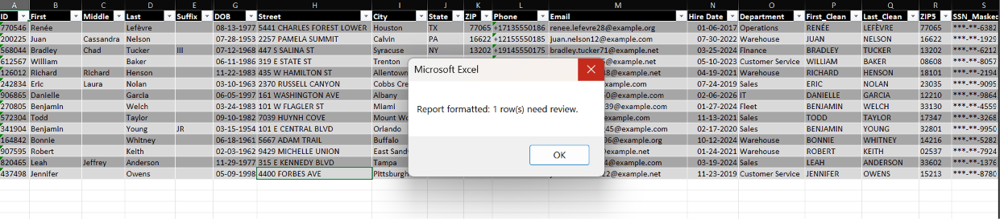
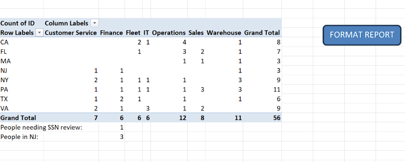
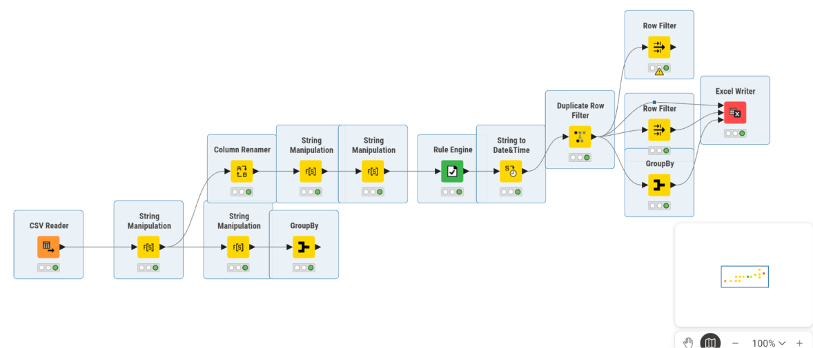
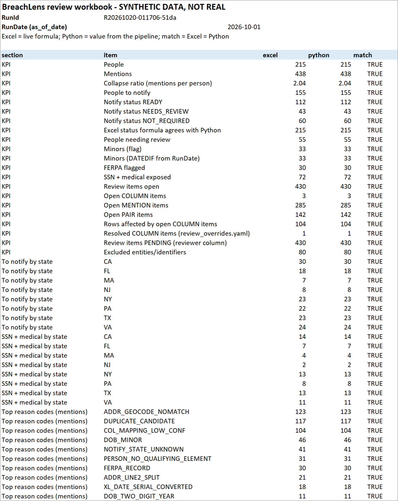
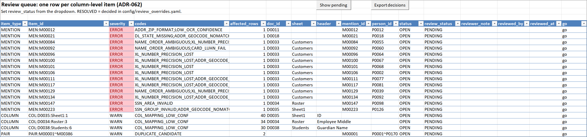
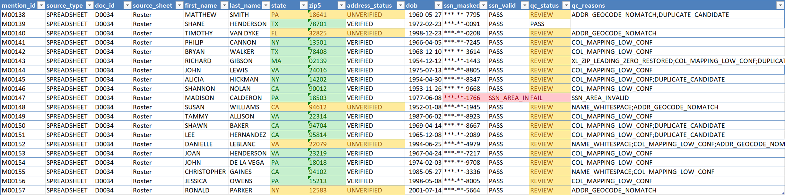

# BreachLens

After a data breach, a company has to find out who was in the stolen files, what of
theirs was exposed, and which state's notification law applies to each person.
BreachLens does this on **synthetic** breach data: PDFs, scanned forms and messy
Excel/CSV exports. It extracts names, addresses and identifiers from both, validates
them, checks addresses against the US Census geocoder, and matches the same person
across files. The result is **one de-duplicated, privacy-safe notification list per
state**, plus an Excel review workbook with live formulas and macros. Raw identifiers
never reach an output file; only masked values and salted keys do. All data is
synthetic, and nothing here is legal advice.

**Start here → [My hands-on work](#my-hands-on-work)**

## My hands-on work

I built these parts myself, by hand, to show core data skills. The larger pipeline was
written with an AI coding agent under my design and review.

| Skill | What I did | Link |
|---|---|---|
| pandas | Cleaned an HR roster and a payroll export: header row, lost leading zeros (6 ZIPs, 8 SSNs), decimal commas, suffixes in names, duplicates. Combined them: **96 rows → 56 unique people** (payroll 80 rows → 40 employees) | [notebook](notebooks/01_explore_messy_files.ipynb) |
| Excel | Cleaned the HR roster by hand: **1 duplicate removed, 56 people, 1 impossible SSN flagged**. TRIM/UPPER, TEXT for ZIPs, IF/OR checks, DATEDIF, XLOOKUP, PivotTable, COUNTIFS, and a recorded-then-edited macro | [excel/manual/](excel/manual/) |
| SQL | 5 queries on the DuckDB results: WHERE, GROUP BY, JOIN, CTE + `unnest`. Cross-checked: q1 (people to notify by state, 155), q2 (notify status 112/43/60) and q5 (top 10 reason codes) equal the workbook's Excel formulas and the Python counts | [sql/queries/](sql/queries/) |
| KNIME | A 14-node workflow, built-in nodes only, that cleans the payroll export: **80 rows → 40 employees**, SSNs padded and masked so no full SSN shows in any node view, and a regex check that finds **0 rows** with a long digit run left | [knime/](knime/) |

**Same file, three tools:** `payroll_export.csv` was cleaned in pandas, KNIME and the
pipeline. All give 80 rows → 40 employees and 8 short SSNs fixed.

### Excel


*Excel cleanup: helper-column formulas (First_Clean, Last_Clean, ZIP5, SSN_Masked),
REVIEW highlight, and the macro's message; the raw SSN column is hidden by the macro.*


*Excel summary: pivot of people by state and department, SSN-review and NJ counts, and
the FORMAT REPORT macro button.*

### KNIME


*KNIME 5.12: the 14-node payroll cleanup, built by hand and exported as
[breachlens_sheet_cleanup.knwf](knime/breachlens_sheet_cleanup.knwf). SSNs are padded
and masked in the first String Manipulation; the warning on the top Row Filter is the
expected 0-row check.*

### SQL

Five queries in [sql/queries/](sql/queries/), run read-only with `breachlens sql run`.
[q4_minors.sql](sql/queries/q4_minors.sql) joins people to the notification list
(11 minors need a guardian notice on corpus_v1):

```sql
-- Q4: List minors who need a guardian notice (person id, state, note).
SELECT p.person_id, n.jurisdiction, n.notify_status, n.notify_note
FROM people p
JOIN notification_list n
  ON p.run_id = n.run_id
 AND p.person_id = n.person_id
WHERE p.is_minor
  AND n.notify_required
ORDER BY p.person_id;
```

### pandas

[notebooks/01_explore_messy_files.ipynb](notebooks/01_explore_messy_files.ipynb)
cleans both files step by step. One example: the payroll SSNs that lost their leading
zero are padded back to 9 digits, then shown only masked:

```python
pay["SS#"] = pay["SS#"].str.zfill(9)
pay["SSN"] = pay["SS#"].str[:3] + "-" + pay["SS#"].str[3:5] + "-" + pay["SS#"].str[5:]
print(pay["SS#"].str.len().value_counts())
pay["SSN"].map(mask).head()
```

## Results

Measured on synthetic data with `breachlens evaluate pipeline` (full numbers:
[sample_output/METRICS.md](sample_output/METRICS.md)). corpus_v1 is the development
corpus the rules were tuned on. The seed-43 holdout was generated separately and scored
without any tuning.

| metric | corpus_v1 (dev) | holdout seed 43 (untuned) |
|---|---|---|
| Notification list vs ground truth (people) | **155/155** | **159/159** |
| Matching, pairwise precision / recall | 1.000 / 0.933 | 1.000 / 0.918 |
| Planted validation cases caught | 306/306 | 299/302 |
| Address status vs expected (Census) | 396/398 | 386/394 |

**Scale:** a 50,000-row claims file runs end to end in **~39 s** (about 1,290 rows/s,
peak memory ~1 GB; [scale_report.json](sample_output/scale_report.json)).

## Screenshots

The review workbook ([sample_output/breachlens_review_corpus_v1.xlsm](sample_output/)).


*Summary: every count is a live Excel formula (`excel`) next to the pipeline's value
(`python`); all 47 match after a LibreOffice recalculation.*


*Review_Queue: one row per item to check, a status dropdown, and the two macro buttons
(Show pending, Export decisions).*


*Mentions: every extracted record with its validation result; identifiers appear only
masked.*

## How it works

1. **Two input tracks:**
   - PDFs and scans: text layer or OCR, then label-anchored field extraction.
   - Spreadsheets: layout repair, then column mapping by header rules plus an ML column
     classifier.

   Both write one `mentions` table.
2. **Normalize and validate** with ~60 reason codes (SSN, card, routing, DOB, address).
3. **Verify addresses** with the Census batch geocoder (cached), then **mask** every
   identifier and replace it with a salted HMAC key.
4. **Match people** with engineered pair features (name, DOB, address, keys), blocking,
   guards and union-find clusters.
5. **Apply state notification rules** (illustrative subset). Write the DuckDB database
   and the review workbook.

Details: [docs/METHODS.md](docs/METHODS.md) and [docs/ARCHITECTURE.md](docs/ARCHITECTURE.md).

## Quick start (Windows, PowerShell)

Needs Python 3.11, [Tesseract OCR](https://github.com/UB-Mannheim/tesseract/wiki) and
[LibreOffice](https://www.libreoffice.org/). The generator uses LibreOffice to write the
`.xls` test file, and `report` uses it to recalculate the workbook formulas as a check.

```powershell
py -3.11 -m venv .venv; .venv\Scripts\Activate.ps1; pip install -e .
copy .env.example .env   # set BREACHLENS_SALT (e.g. python -c "import secrets; print(secrets.token_hex(32))"), TESSERACT_CMD, SOFFICE_PATH
breachlens generate; breachlens generate --seed 43 --out data/raw/corpus_holdout --corpus-only
breachlens train column-classifier   # the model file is not in git
breachlens run; breachlens db build
breachlens report                    # data/output/<run_id>/breachlens_<run_id>.xlsm
```

Optional: `breachlens evaluate pipeline` (METRICS.md), `breachlens scale-test` (50k
rows), `breachlens sql run` (the queries above).

**Census, offline by default:** `data/cache/census/` is committed. It holds the Census
answers for the synthetic addresses only, with no names or identifiers. So a fresh clone
gets real address statuses with no network call. `breachlens run --online` is only needed
for addresses that are not cached yet (e.g. a new seed). It sends street, city, state and
ZIP only. Without it, uncached addresses are `NOT_CHECKED`.

**Macros:** a workbook downloaded from the internet opens with macros blocked (Mark of
the Web). Right-click the file → Properties → tick **Unblock**.

## Known limitations

- **Review volume:** 43 people need review on corpus_v1, against 10 review cases in the
  ground truth. Most are household members who share a surname and address but have no
  DOB on one side. A name alone never merges, by design.
- **Synthetic data only:** rules and OCR settings were tuned on corpus_v1. The untuned
  holdout shows lower OCR accuracy (name 7/9 on scans). Real exports will show damage
  the generator does not produce.
- **Addresses:** Census confirms an address range, not USPS deliverability. Its batch
  geocoder rejects 2 corpus_v1 addresses that a single lookup matches.

More: [docs/ASSUMPTIONS_LIMITATIONS.md](docs/ASSUMPTIONS_LIMITATIONS.md).

**Optional / future:** "Ask BreachLens", a local-LLM text-to-SQL assistant over the
database, is designed ([DATABASE_AND_ASK.md](docs/DATABASE_AND_ASK.md)) but not
built in v1.0.

## Privacy and links

- **Privacy by design:**
  - Synthetic data only. Raw identifiers are dropped before anything is written, leaving
    masked values (`***-**-1234`) and salted keys.
  - A leak guard scans every output file.
  - Offline by default.
  - The salt lives in `.env`, which is git-ignored and has never been committed
    ([docs/PRIVACY.md](docs/PRIVACY.md)).
- **Not legal advice:** the notification rules in `config/jurisdictions.yaml` are an
  illustrative subset.
- **Docs:**
  - [Methods](docs/METHODS.md), [Assumptions & limitations](docs/ASSUMPTIONS_LIMITATIONS.md),
    [Design rationale](docs/DESIGN_RATIONALE.md), [Decisions (ADRs)](docs/DECISIONS.md)
  - [Data schema (handoff contract)](docs/DATA_SCHEMA.md),
    [Validation rules](docs/VALIDATION_RULES.md), [Spreadsheet track](docs/SPREADSHEET_TRACK.md)
  - [Review workbook](docs/EXCEL_WORKBOOK.md),
    [Column classifier model card](models/model_card.md), [Progress log](PROGRESS.md)
