# ARCHITECTURE.md

## Pipeline overview

```mermaid
flowchart LR
  subgraph PDF[Unstructured track]
    P1[PDFs + scans] --> P2[Text extraction<br/>pdfplumber / Tesseract]
    P2 --> P3[Doc-type rules]
    P3 --> P4[Label-anchored field extraction]
    P4 --> P5[PERSON vs ORG,<br/>SSN vs EIN/NPI]
  end
  subgraph XL[Structured track]
    S1[Excel / CSV / XLS] --> S2[Read + profile]
    S2 --> S3[Fix layout<br/>header, merged, totals]
    S3 --> S4[Column mapping<br/>rules + ML classifier]
    S4 --> S5[Repair Excel damage<br/>unpivot, free-text scan]
  end
  P5 --> M[(mentions<br/>one schema)]
  S5 --> M
  M --> N[Normalize] --> V[Validate<br/>reason codes] --> A[Address<br/>ZIP check → Census]
  A --> PR[Privacy<br/>mask + HMAC + drop raw]
  PR --> R[Entity resolution<br/>engineered pair features]
  R --> T[Notification triggers<br/>state + FERPA + minor]
  T --> DB[(DuckDB<br/>system of record)]
  T --> WB[Excel review workbook<br/>formulas + macros]
  WB -- review decisions --> DB
  DB --> ASK[Ask BreachLens<br/>local LLM → guarded SQL]
```



Both tracks write the **same `mentions` schema**. Everything downstream is
source-agnostic.

## Design principles
1. Stages are functions: `run(df, ctx) -> df`. No hidden state. Each can be wrapped as
   a KNIME node.
2. Rules and mappings live in config (`config/*.yaml`), validated by pydantic.
3. Every decision is explainable: reason codes, audit events, mapping confidence.
4. Raw sensitive values exist only in `_raw_*` columns until the privacy step.
5. Deterministic: fixed seeds, sorted outputs, cached API calls.
6. **Handoff contract:** output tables follow `DATA_SCHEMA.md` exactly. Schema
   changes need an ADR and a `schema_version` bump.

## Context
```python
@dataclass
class Context:
    config: PipelineConfig
    run_id: str              # R20261017-153000-ab12 (ADR-027)
    paths: Paths
    audit: AuditLogger
    salt: bytes
    offline: bool
    schema_version: str = "1.1"
```

## Repo layout
```
breachlens/
├── AGENTS.md  CLAUDE.md  README.md  PROGRESS.md  pyproject.toml  .env.example
├── config/
│   ├── pipeline.yaml  rules.yaml  jurisdictions.yaml  dl_formats.yaml
│   ├── address_abbrev.yaml  nicknames.csv
│   ├── header_aliases.yaml        # rules baseline for column mapping
│   ├── doc_templates/*.yaml       # 4 PDF types × 2 layouts
│   └── ask.yaml                   # LLM provider, model, allowed tables, row limit
├── src/breachlens/
│   ├── cli.py config.py context.py models.py pipeline.py
│   ├── ingest/     inventory.py text_extract.py ocr.py
│   ├── classify/   doctype.py  doctype_ml.py (optional A)
│   ├── extract/    templates.py identifiers.py entity_type.py
│   ├── sheets/     reader.py profile.py layout.py features.py mapping.py
│   │               repair.py reshape.py freetext.py
│   ├── ml/         column_classifier.py  match_model.py (optional B)  common.py
│   ├── normalize/  names.py addresses.py dates.py contact.py
│   ├── validate/   engine.py ssn.py luhn.py aba.py dl.py dob.py completeness.py
│   ├── address/    zipcheck.py census.py cache.py
│   ├── privacy/    masking.py hashing.py leak_guard.py
│   ├── resolve/    keys.py features.py scoring.py cluster.py survivorship.py
│   ├── notify/     triggers.py
│   ├── db/         load.py
│   ├── report/     excel_writer.py formulas.py recalc.py
│   ├── review/     apply.py
│   ├── ask/        schema_card.py prompt.py providers.py guard.py executor.py
│   ├── evaluate/   metrics.py ask_eval.py scale.py
│   ├── audit/      log.py
│   └── synth/      people.py render_pdf.py scanify.py render_sheets.py   (ADR-045)
│                   column_corpus.py scale.py ground_truth.py address_pool.py
├── excel/          ReviewHelpers.bas  vbaProject.bin (built once by a human)
├── sql/            views/*.sql (6 analytical)  views/ask/ask_*.sql (key-free projections)
│                   queries/Q01..Q20.sql (scored)  fewshot/F01..F04.sql  snapshots/*.csv
├── knime/          nodes/*.py  environment.yml
├── models/         column_classifier.joblib (+ model_card.md)
├── data/  reference/  raw/sample/ (committed)  cache/  output/
│          raw/corpus_v1/{docs,truth}/  raw/column_corpus/  raw/scale/   (git-ignored, ADR-047)
├── sample_output/
├── tests/          unit/ integration/ test_leak_guard.py test_ask_guard.py
└── docs/
```

## Stage details

### Ingest (both tracks)
`inventory`: one row per file. `doc_id` (`D0001`…), `path`, `file_kind`
(`PDF`/`XLSX`/`XLS`/`CSV`), sha256, bytes, pages or sheets, `has_text_layer`,
`is_exact_duplicate`, `doc_date` (nullable; ADR-029).

### Unstructured track
- **Text:** pdfplumber words with boxes. No text layer → PyMuPDF raster at 300 dpi →
  `pytesseract.image_to_data` with confidences. Both produce one token table.
- **Doc type:** keyword scores from template YAML. Below threshold → `UNKNOWN` and review.
- **Fields:** template YAML `persons:` blocks (role → fields). Each field has `label`
  regex, `direction` (right/below), `max_distance`, `pattern`, and `target` column.
  Confidence is 1.0 for text-layer tokens, mean OCR conf/100 otherwise.
- **Identifiers:** label proximity decides SSN / EIN / ITIN / NPI. Business IDs go to
  `excluded_identifiers`.
- **Entity type:** org-suffix lexicon + field role + nameparser sanity → ORG rows go to
  `excluded_entities`.

### Structured track
See `SPREADSHEET_TRACK.md`. Output: `mentions` rows with provenance
(`source_file`, `source_sheet`, `source_row`), plus `file_profile`, `column_profile`
and `column_mapping` tables.

### Normalize → Validate → Address → Privacy
- Normalizers keep the raw string (`raw_name`, `raw_address`).
- The rule engine appends reason codes. `qc_status` = FAIL if any ERROR, else REVIEW if
  any WARN, else PASS.
- Address: offline ZIP check, then the Census batch geocoder
  (`/geocoder/locations/addressbatch`, `benchmark=Public_AR_Current`, ≤ 10,000 rows per
  batch, cached by request hash). Status mapping is in `VALIDATION_RULES.md`.
- Privacy: trio columns + HMAC keys, then `drop_raw()`. `leak_guard` runs before every
  write.

### Entity resolution (`resolve/`)
- **Engineered pair features** (`resolve/features.py`), one row per candidate pair,
  persisted to `pair_features`:
  - `f_first_jw`: Jaro-Winkler on first name after nickname expansion
  - `f_last_jw`: Jaro-Winkler on last name
  - `f_dob`: 1 exact / 0.7 day-month transposed / 0.3 same year / 0 different / null
  - `f_zip_eq`
  - `f_addr_tsr`: token-set ratio on address line 1
  - `f_ssn_key_eq`, `f_dl_key_eq`: 1 / 0 / null
  - `f_same_source_file`
  - `f_mi_eq`: middle initial equal
- **Passes:**
  - A: same `ssn_key`, unless DOB conflicts (then REVIEW).
  - B: same `dl_key` + state, or same `passport_key`.
  - C: blocked on soundex(last) OR DOB. Weighted score
    `0.25 f_first_jw + 0.25 f_last_jw + 0.25 f_dob + 0.10 f_zip_eq + 0.15 f_addr_tsr`.
    Score ≥ 0.90 merges; 0.70–0.90 → REVIEW.
- **Guards:** both `ssn_key` present and different → never merge. Conflicting DOB →
  score capped at 0.69.
- **Clusters:** union-find → `person_id`. `cluster_confidence` = minimum edge score.
- **Survivorship:**
  - Name: the most complete version.
  - Address: newest `doc_date` (nulls last), then the most frequent VERIFIED address,
    then the highest confidence (ADR-029).
  - DOB: the mode of the valid values.
  - Element flags: OR across mentions.
  - `source_docs`: the sorted unique list.
- Optional B swaps the weighted score for a learned model on the same features
  (`ML_MODELS.md`).

### Notification (`notify/`)
- **Trigger:** jurisdiction = the golden-record state. `notify_required` = name +
  ≥ 1 covered element for that state (`jurisdictions.yaml`).
- **Notes:**
  - `is_minor` → "Notify parent/guardian".
  - `ferpa_flag` = education-record elements exposed → note "Education record
    exposed — FERPA considerations for the institution". This is an informational flag,
    **not** a state-law trigger.

### Outputs
- `data/output/<run_id>/breachlens_<run_id>.xlsm`: see `EXCEL_WORKBOOK.md`.
- `data/output/breachlens.duckdb`: see `DATABASE_AND_ASK.md`. This file accumulates
  runs over time, so every key is composite with `run_id` (ADR-030).
- `audit_<run_id>.jsonl`, `metrics.json`, `METRICS.md`, `scale_report.json`.

## KNIME integration
- **Unstructured track:** Python Script nodes wrap the package stages.
- **Structured track:** mostly native nodes:
  - Excel Reader / CSV Reader (encoding set by flow variable)
  - Row Filter (drop title and total rows)
  - Column Renamer (driven by the `column_mapping` table, joined from a Python node)
  - String Manipulation (trim, upper, ZIP padding with `padLeft`)
  - Unpivot (dependent columns)
  - Duplicate Row Filter
  - Rule Engine (`qc_status` preview)
- **Shared downstream:** Python nodes for validation, privacy, matching and export.
  GroupBy by state goes to an Excel Writer summary.

Node script pattern:
```python
import knime.scripting.io as knio
from breachlens.pipeline import load_context, stage_validate
ctx = load_context(knio.flow_variables["config_path"])
knio.output_tables[0] = knio.Table.from_pandas(stage_validate(knio.input_tables[0].to_pandas(), ctx))
```
